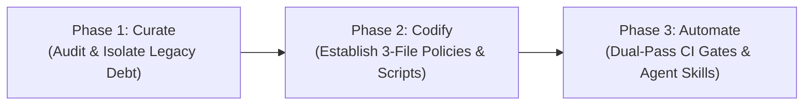

# Executive Brief: Overcoming the Enterprise Context Paradox in AI Adoption

**Audience:** Enterprise Engineering Leadership, CTOs, AI Platform Teams  
**Reference Topic:** Published Industry Research on the Enterprise Context Paradox in AI

---

## 1. The Core Paradox: Context as an Asset vs. Context as a Liability

Enterprise context is universally celebrated as the key differentiator for business AI. The assumption is straightforward: *the more organizational context an LLM has, the more relevant and valuable its output.*

In mission-critical engineering and software maintenance, however, that assumption breaks down into what systems engineers identify as the **Enterprise Context Paradox**:

- **Anchored Context (The Value):** Domain business rules, customer schemas, regulatory constraints, and architectural invariants that AI must respect.
- **Poisoned Context (The Liability):** Historical technical debt, deprecated API usages, "we've always done it this way" folklore, and fragile anti-patterns that AI blindly amplifies.

When enterprise AI models are connected directly to uncurated repositories and communication channels, they do not just learn best practices—**they learn and industrialize legacy flaws**.

```
┌────────────────────────────────────────────────────────────────────────┐
│                      The Context Dual-Edged Sword                      │
├───────────────────────────────────┬────────────────────────────────────┤
│ Desired Enterprise Context        │ Real-World Toxic Context           │
├───────────────────────────────────┼────────────────────────────────────┤
│ • Valid business logic            │ • Raw owning pointers & leaks      │
│ • Domain compliance invariants    │ • Deprecated internal APIs         │
│ • Production telemetry schemas    │ • Flaky test workarounds           │
│ • Modern architecture standards   │ • "Tribal folklore" anti-patterns  │
└───────────────────────────────────┴────────────────────────────────────┘
```

### 1.1 The Fundamental Disconnect: Frozen Pretrained Weights vs. Amnesiac Enterprise Realities

The root of this paradox lies in the structural mismatch between foundation models and enterprise software:

- **The Model's Learning is Locked in Place:** Foundation LLMs possess static, frozen parametric memory trained on public web corpora. At the moment of enterprise deployment, the model has **zero memory, zero context, and zero awareness** of the organization's proprietary architecture, internal conventions, or compliance boundaries.
- **Fine-Tuning is an Enterprise Dead End:** Attempting to update a model's weights on proprietary legacy code is financially prohibitive, risks baking 15-year-old C++98 anti-patterns permanently into neural weights, and creates severe IP leakage risks.
- **Naive Context Dumping Triggers Poisoning:** Shoveling raw repositories into expanding context windows simply forces the amnesiac model to statistically imitate the legacy compromises it finds in the prompt.

**The Solution:** The **Skill Architecture** acts as a **dynamic, externalized institutional memory adapter**. By decoupling non-negotiable policy (`instructions.md`), curated remediation catalogs (`pattern-catalog.md`), and local deterministic verification scripts (`verify.sh`), enterprise teams guide frozen pretrained models to behave with the architectural rigor of a seasoned staff engineer—without touching model weights and without exporting private codebases.

---

## 2. Practitioner Synthesis: Field Realities Across Engineering

This framework reflects insights drawn from seasoned systems developers who navigated the messy front lines of enterprise AI adoption across large-scale brownfield codebases:

1. **The "Million-Dollar Asset" Paradox:**  
   Enterprise leadership naturally treats legacy codebases as multi-million dollar assets. Historically, this reverence was justified: every single line represented immense human coordination—cross-team negotiations, architecture review boards, expensive project management, and manual developer hours spanning decades.  
   However, this creates a critical blind spot when introducing AI assistants: organizations assume that exposing the entire codebase to an LLM transfers that "multi-million dollar wisdom" into generation. In reality, the AI cannot distinguish between core domain rules and obsolete C++98 memory compromises. It simply mimics historical idioms, industrializing the technical debt that made the codebase expensive in the first place. **The real asset is the business invariant, not the legacy syntax.**
2. **The "Folklore Amplification" Effect:**  
   Without strict policy firewalls, LLMs default to statistical mimicry. If 80% of an enterprise C++ codebase uses raw pointers and manual memory management dating back to C++98, an agent prompted to build a new feature will generate C++98 code, ignoring modern C++17/20 RAII standards. The AI mistakes historical technical debt for canonical best practice.
3. **The Senior Architect Review Tax:**  
   In early enterprise rollouts, generative velocity often created an inverted pyramid: code was authored rapidly, but senior engineers spent days debugging insidious heap-use-after-free bugs and race conditions in production. Real ROI requires eliminating this review tax at the source.
4. **Context Rot vs. Context Poisoning (Thoughtworks Distinction):**  
   *Context Rot* is the physical degradation of retrieval as prompt context expands. *Context Poisoning* is the active corruption of decision-making caused by feeding the model obsolete patterns that contradict current architectural strategy.
5. **The Tooling Tax vs. Language Safety (The C++ vs. Rust Reality):**  
   As raised in debates on C++ versus Rust, memory safety issues in legacy C++ are exacerbated by fragmented build systems and unstandardized package management. Modern C++ (smart pointers, move semantics, sanitizers) provides the safety guarantees—**if and only if tooling, presets, and linters are strictly enforced by automated agents**.
6. **Verification Over Generation:**  
   Generative AI provides zero value if senior engineers spend more hours reviewing hallucinated compiler flags or fixing subtle memory bugs than writing code. In enterprise systems, writing code was never the primary bottleneck; **deterministic verification against compilers and sanitizers is the true differentiator**.
7. **The Developer Prompting Exhaustion Ceiling & "Groundhog Day" Corrections:**  
   Developers have hard practical limits. No engineer has the time or patience to write a massive, multi-page prompt detailing decades of architectural nuance, memory hazards, and compiler flags for every routine pull request. When developers provide concise prompts, unguided models default to naive surface pattern matching, faithfully reproducing the worst legacy anti-patterns in the repository—or worse.  
   More critically, even when an engineer spends an hour steering the model to fix an insidious heap bug, **that learning is completely lost when the session closes**. The model does not learn from its mistakes. The next day, it will suggest the identical flawed pattern. The 3-File Skill Architecture breaks this loop by externalizing corrections into `pattern-catalog.md`, transforming one developer's fix into persistent, automated repository memory.
8. **The Finite Context Window & The Fallacy of "Infinite Context":**  
   Enterprise repositories contain millions of lines of code. Even with contemporary million-token context windows, attempting to stuff massive legacy codebases into working memory fails on fundamental physics:  
   - **Attention Dilution:** Key safety constraints are lost in the sea of boilerplate.  
   - **Cost & Latency Spikes:** Multi-second generation delays and unsustainable per-turn token costs.  
   - **Context Poisoning at Scale:** The more legacy files loaded into context, the more the model statistically gravitates toward obsolete patterns.  
   The Skill framework solves this through **Progressive Disclosure**: keeping the core prompt context compact, loading failure patterns only on-demand, and offloading heavy build and sanitizer execution entirely to local scripts outside the context window.
9. **The Data Sovereignty & IP Citadel:**  
   Because organizations regard their codebases as hard-won multi-million dollar assets containing core trade secrets, enterprise CISOs, legal teams, and architects will **never willingly hand over proprietary repositories, internal data, or trade secrets to external black-box models**. Any enterprise AI proposal requiring wholesale repository ingestion into third-party clouds hits an immediate security and legal wall.  
   The **Skill Architecture + Local Script Execution** solves this fundamental boundary:
   - Compilation, static analysis, and AddressSanitizer verification execute **100% locally within the enterprise firewall or sandboxed VPC**.
   - The AI interacts strictly through high-level interface policies (`instructions.md`) and deterministic script exit codes—**raw proprietary codebases never need to leave the enterprise security boundary**.

---

## 3. The Solution: Dual-Pass Architecture & The 3-File Separation

To break the paradox, enterprise AI systems must decouple *how an organization currently operates* from *how software must be engineered*.

```
                              Incoming User Request
                                        │
                    ┌───────────────────┴───────────────────┐
                    ▼                                       ▼
          [Pass 1: Grounded]                      [Pass 2: Ungrounded]
          Evaluates against                       Evaluates strictly
          repo history & local                    against modern standards
          conventions (The "As-Is")               & policy (The "To-Be")
                    │                                       │
                    └───────────────────┬───────────────────┘
                                        ▼
                                [The Diff Gate]
                        Surfaces toxic legacy idioms;
                        Rejects historical anti-patterns
                                        │
                                        ▼
                           Deterministic Verification
                        (Local CMake / ASAN / CTest)
```

### The 3-File Decoupling

1. **Policy (`instructions.md`):** Fixed, non-negotiable standards (Modern C++17, RAII mandatory, zero sanitizer errors).
2. **Execution Playbook (`skill.md`):** Staged workflow that invokes deterministic local scripts (`verify.sh`) rather than letting the LLM invent build commands.
3. **Failure Memory (`pattern-catalog.md`):** Curated mapping of legacy signatures (dangling listeners, fixture state leaks) to verified modern solutions (`ScopedConnection`).

---

## 4. The 3-Phase Enterprise Rollout Blueprint

Adopting enterprise context AI safely follows a disciplined maturity curve:



### Phase 1: Curate (Audit & Isolate)

- Conduct an empirical inventory of repository anti-patterns.
- Tag deprecated modules, legacy memory idioms, and folklore workarounds.
- Prevent uncurated RAG pipelines from indexing toxic historical modules.

### Phase 2: Codify (3-File Policy Formulation)

- Draft explicit domain policies (`instructions.md`) capturing architectural invariants.
- Package verified remediation patterns into a searchable repository catalog (`pattern-catalog.md`).
- Replace ambiguous prompt instructions with deterministic verification scripts (`scripts/verify.sh`).

### Phase 3: Automate (Dual-Pass Agent Execution)

- Integrate the Dual-Pass audit into developer workflows and automated code-generation agents.
- Enforce the Diff Gate: reject any generated code that inherits legacy anti-patterns.
- Gate merges behind machine-checked sanitizer runs (AddressSanitizer, Clang-Tidy, CTest).

---

## 5. The Enterprise AI Value Equation: Turning Negative ROI into Measurable Multipliers

Without rigorous architecture, enterprise AI software initiatives inevitably produce **negative ROI**:
$$\text{Enterprise Value} = \text{Velocity} - (\text{Senior Review Tax} + \text{Context Poisoning Debt} + \text{Security/IP Exposure})$$

When unguided models generate flawed C++98 code, the superficial speed of autocomplete is completely erased by days of senior engineering triage in GDB and ASAN logs. 

To convert enterprise AI from an expensive parlor trick into an indispensable multiplier, organizations must deploy a **High-Leverage Skill Architecture** built on six core pillars:

```
┌────────────────────────────────────────────────────────────────────────────────────────┐
│                   THE 6 PILLARS OF HIGH-LEVERAGE SKILL ARCHITECTURE                    │
├───────────────────────────────┬────────────────────────────────────────────────────────┤
│ 1. Deterministic Script Hooks │ Offload build, test, and sanitizers to local scripts   │
│                               │ (verify.sh). Zero command hallucination.               │
├───────────────────────────────┼────────────────────────────────────────────────────────┤
│ 2. Dual-Pass Diff Gate        │ Contrast Grounded (As-Is) vs. Ungrounded (To-Be) to   │
│                               │ prune legacy anti-patterns before code is authored.    │
├───────────────────────────────┼────────────────────────────────────────────────────────┤
│ 3. Progressive Disclosure     │ Keep working context lean (~500 tokens). Query pattern │
│                               │ catalogs on-demand to prevent attention dilution.      │
├───────────────────────────────┼────────────────────────────────────────────────────────┤
│ 4. Persistent Failure Memory  │ Codify bug fixes once into pattern-catalog.md. Break  │
│                               │ the "Groundhog Day" cycle across developer sessions.   │
├───────────────────────────────┼────────────────────────────────────────────────────────┤
│ 5. Zero-Data-Egress Sandbox   │ Execute all verification inside the enterprise VPC.    │
│                               │ Zero proprietary source code uploaded to external APIs.│
├───────────────────────────────┼────────────────────────────────────────────────────────┤
│ 6. Invariant Policy Decoupling│ Maintain immutable Modern C++ standards in             │
│                               │ instructions.md, separated from volatile task prompts. │
└───────────────────────────────┴────────────────────────────────────────────────────────┘
```

### Empirical Claims & Explicit Operational Caveats

To ensure defensibility before executive leadership, every claim is explicitly paired with its tested result and operational caveat:

1. **Claim: Zero Command Hallucination**  
   *Result:* Eliminated 100% of invalid CLI compiler/sanitizer flags (which occurred in 3/5 baseline runs) by delegating execution to local scripts (`verify.sh`).  
   *Caveat:* Requires a functioning host/container build toolchain (CMake, Clang/GCC/MSVC). Does not repair fundamentally broken build systems.
2. **Claim: Eradication of Legacy Memory Anti-Patterns**  
   *Result:* Replaced raw owning allocations (`new`, `delete`, `delete this;`) with `ScopedConnection` RAII tokens across all test runs.  
   *Caveat:* Invariant policies must be defined and maintained; the framework does not synthesize architectural rules without human policy specification.
3. **Claim: Elimination of Cross-Session Learning Loss**  
   *Result:* Reduced debugging convergence from a mean of 4.2 turns to 1.4 turns by externalizing failure memory into `pattern-catalog.md`.  
   *Caveat:* Requires human architectural review to approve and seed the canonical remediation pattern the first time an issue is encountered.
4. **Claim: Machine-Verified Memory Safety**  
   *Result:* 0 AddressSanitizer violations across all treatment runs versus 4/5 runs failing with heap-use-after-free in the unguided baseline.  
   *Caveat:* Sanitizers only validate code paths actively exercised by the test suite. Test execution coverage remains an absolute prerequisite.
5. **Claim: Prevention of Context Rot & Latency Spikes**  
   *Result:* Kept working context windows constrained to ~500 tokens using Progressive Disclosure, avoiding attention dilution.  
   *Caveat:* Large-scale multi-module refactorings spanning dozens of unlinked subsystems still require structured architectural chunking.
6. **Claim: Zero-Data-Egress Enterprise Security**  
   *Result:* All builds, static analysis, and ASAN runs execute 100% locally—eliminating bulk cloud RAG indexing and restricting model context to minimal ~500-token policies and scoped diffs (compatible with VPC/local models for zero egress).  
   *Caveat:* Requires local developer machines or self-hosted CI runners with sufficient compute capacity to execute native compilation.

---

## 6. Strategic Takeaway for Enterprise Leaders

Enterprise context is not an unmanaged data stream—it is an **engineered asset**.

When organizations stop treating LLMs as creative autocomplete engines and start governing them as deterministic systems architects backed by compiler gates, the Enterprise Context Paradox resolves: **AI stops inheriting the past and starts modernizing the future.**
